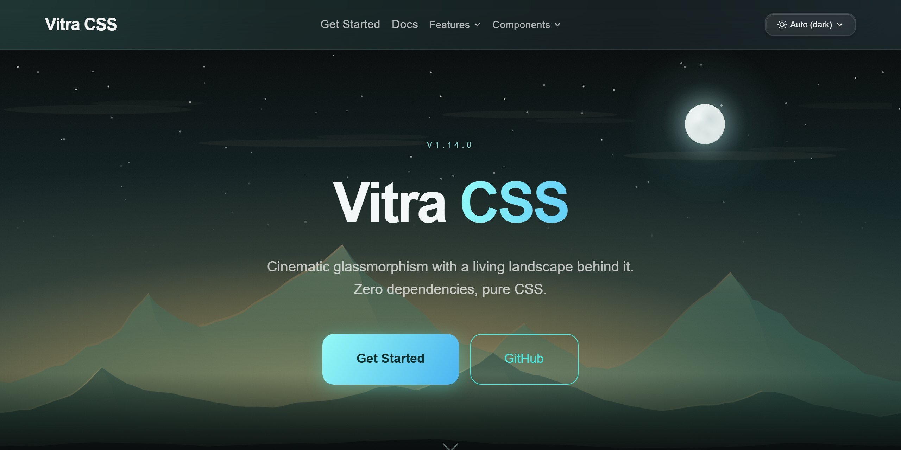

# Vitra CSS

[](https://github.com/DesvoSoft/Vitra/actions/workflows/build.yml)
[](https://github.com/DesvoSoft/Vitra/releases)
[](LICENSE)
[](#sizes)
[](#trust)

A CSS framework for glass surfaces, ambient motion and a living landscape behind your content. One stylesheet, an optional 7 kB script, no dependencies, no build step.

[](https://desvosoft.github.io/Vitra/)

**[Live demo](https://desvosoft.github.io/Vitra/)** · **[Documentation](https://desvosoft.github.io/Vitra/docs/)** · [Integration guide](docs/integration.md) · [Themes](docs/themes.md) · [Changelog](CHANGELOG.md)

---

## Quick Start

Add one line to any HTML page:

```html
<link rel="stylesheet" href="https://cdn.jsdelivr.net/gh/DesvoSoft/Vitra@v1.14.1/dist/vitra.min.css" integrity="sha256-VqvCW9TWtiiiYglM8Ok1T1Y/tbXZ8sWvYvW7i/fPZko=" crossorigin="anonymous">
```

The script is optional. It adds modals, the drawer, tooltips, toasts, dropdown keyboard support, particles and theme switching:

```html
<script src="https://cdn.jsdelivr.net/gh/DesvoSoft/Vitra@v1.14.1/dist/vitra.min.js" integrity="sha256-XfDZdHFCtz3eXkyZ82L9abRDbp+yhwDFOvvsWNpqjFw=" crossorigin="anonymous" defer></script>
```

Then write markup:

```html
<html data-theme="dark">
<body>
  <div class="vitra-scenery"></div>            <!-- the landscape, fixed behind the page -->

  <main class="vitra-glass" style="max-width: 32rem; margin: 20vh auto; padding: 2rem;">
    <h1>Hello, Vitra</h1>
    <p>A glass panel over a living scene.</p>
    <button class="vitra-btn vitra-btn-solid">Get started</button>
  </main>
</body>
</html>
```

The URLs are pinned to a release tag and carry Subresource Integrity hashes, so the browser refuses the file if it ever differs from what was published. The hashes of every distributed file are in [`dist/SRI.txt`](dist/SRI.txt).

### Other ways to load it

**Local files.** Download `dist/vitra.min.css` (and `dist/vitra.min.js`) from a [release](https://github.com/DesvoSoft/Vitra/releases) and serve them yourself.

**With a bundler.** Install from GitHub, pinned to a tag:

```bash
npm install github:DesvoSoft/Vitra#v1.14.1
```

```js
import 'vitra-css/dist/vitra.min.css';
import { theme, drawer } from 'vitra-css';
```

Vitra is not published on the npm registry. Do not install a registry package named `vitra-css`: it is not this project.

**Only the CSS you use.** `vitra.min.css` is the whole framework. Three pieces carry the same rules split by what they are for:

| Piece | Contains | Brotli |
|-------|----------|--------|
| `dist/vitra.core.min.css` | tokens, themes, glass, motion, layout, components, utilities | 13.0 kB |
| `dist/vitra.scenery.min.css` | the mountain scenery (needs `core`) | 5.0 kB |
| `dist/vitra.effects.min.css` | particles, noise overlay, shape morph, progress ring, gradient-rotate borders, click ripple, scroll reveal (needs `core`) | 2.3 kB |

```html
<link rel="stylesheet" href="dist/vitra.core.min.css">
<link rel="stylesheet" href="dist/vitra.scenery.min.css">  <!-- only if you use .vitra-scenery -->
<link rel="stylesheet" href="dist/vitra.effects.min.css">  <!-- only if you use particles or shader effects -->
```

Load order between the pieces does not matter. Compressed separately the three add up to more than the bundle (20.3 kB against 18.9 kB), so use the pieces to leave one out, not to load all three. With a bundler: `vitra-css/core.css`, `vitra-css/scenery.css`, `vitra-css/effects.css`.

---

## What's in it

-   **Glass surfaces** with `backdrop-filter`, each behind `@supports` with a solid fallback.
-   **Ambient scenery**: a CSS-only mountain landscape with faceted ranges, twinkling stars and a moon. One element of markup; it re-colours itself from the theme's accent.
-   **Components**: buttons, cards, forms, switch, checkbox and radio, tabs, modal, drawer, dropdown, tooltip, toast, progress, badges, alerts, tables, navbar. Each one is checked in every theme, with the keyboard, on touch targets, under reduced motion and without JavaScript.
-   **Seven themes** (`light`, `dark`, `auto`, `pastel`, `neon`, `ocean`, `emerald`) driven by tokens; `auto` follows the system and is generated from `light` and `dark`, so it cannot drift.
-   **Motion that stays off the main thread**: ambient loops animate `transform` and `opacity`, pause when offscreen, and stop under `prefers-reduced-motion`. Spring easing tokens for things that arrive.
-   **Effects**: mesh gradients, glow orbs, gradient text, border glow, aurora, particles, noise, shape morph, scroll reveals.
-   **A strict `@layer` cascade**, so your own CSS always wins without `!important`.

## Trust

A stylesheet and a script that run on other people's pages have to be boring in the right ways:

-   **Zero runtime dependencies.** The distributed files contain no third-party code.
-   **No network access.** The script makes no requests, loads no other script, and uses no `eval` or `innerHTML`. The only browser storage it touches is one `localStorage` key that remembers the chosen theme.
-   **No external resources in the CSS.** Every image is an inline SVG; there are no remote fonts or imports.
-   **Reproducible builds.** `dist/` is committed, and CI fails if a fresh build differs from it. SRI hashes for every file are in `dist/SRI.txt`.
-   **Pinned tooling.** Development dependencies are locked with integrity hashes, and CI actions are pinned to commit SHAs.

To report a vulnerability, see [SECURITY.md](SECURITY.md).

## Sizes

Brotli, measured by `size-limit` on every build:

| File | Size | Budget |
|------|------|--------|
| `vitra.min.css` | 18.9 kB | 20 kB |
| `vitra.min.js` | 7.5 kB | 7.5 kB |
| `vitra.esm.js` | 10.0 kB | 10.6 kB |

---

## Develop

```bash
git clone https://github.com/DesvoSoft/Vitra.git
cd Vitra
npm install
npm run build          # dist/: bundle, pieces, iife/esm/cjs, types, SRI.txt
npm test               # unit tests (vitest + jsdom)
npm run test:browser   # Playwright + axe-core in Chromium and Firefox
npm run dev            # serves the repo; open /tests/kitchen-sink for every component in every state
```

See [CONTRIBUTING.md](CONTRIBUTING.md).

---

## Architecture

Vitra uses a strict @layer cascade to prevent specificity leaks and ensure consistent styling across large projects.

1.  tokens: Immutable design primitives (colors, spacing, shadows).
2.  glass: The core glassmorphism engine.
3.  particles: Background effects and glow systems.
4.  motion: Animation engine and reveal logic.
5.  scenery: Ambient mountain-landscape backdrop.
6.  layout: Structural utilities (Flex, Grid, Container).
7.  components: Premium UI elements (Buttons, Cards, Forms).
8.  utilities: High-precedence helper classes.
9.  shaders: Pure-CSS shader effects.

---

## Themes & Glassmorphism

Vitra supports three core theme modes: light, dark, and auto. It also includes several premium variants: Pastel, Neon, Ocean, and Emerald.

```html
<!-- Apply a theme -->
<html data-theme="dark">

<!-- Apply the signature Glass effect -->
<div class="vitra-glass vitra-glass-md">
  <h2>Premium Content</h2>
  <p>Seamlessly integrated with backdrop-filter.</p>
</div>
```

---

## JS API

The Vitra JS API is modular and declarative. You can configure it via data-config on the script tag or use the global Vitra object.

### Theme Control
```javascript
Vitra.theme.set('neon');          // Switch to neon theme
Vitra.theme.toggle();             // Flip between light/dark
Vitra.theme.getEffective();       // Resolve 'auto' to actual theme

// Animated: the new theme grows as a circle out of the control that was pressed
button.addEventListener('click', (event) => {
  Vitra.theme.toggle({ transition: true, origin: event });
});
```

### Drawer
```html
<button class="vitra-burger" data-vitra-drawer-toggle="#menu" aria-label="Open menu"> … </button>
<div class="vitra-drawer-overlay"></div>
<nav id="menu" class="vitra-drawer" aria-label="Menu"> … </nav>
```
```javascript
Vitra.drawer.open('#menu');   // also close(), toggle(); Esc closes, focus is trapped and returned
```

### Scenery
```javascript
Vitra.scenery.init();                                  // fill every empty .vitra-scenery root (automatic on load)
Vitra.scenery.mount('#hero-bg', { inline: true, moon: 'crescent' });
```

### Always-on helpers
`ripple`, `toast`, `tooltip`, `drawer`, `dropdown`, `spotlight`, `scenery` and `motionGuard` initialize themselves on load. `motionGuard` pauses ambient loops (scenery, glow orbs, aurora, mesh gradient, gradient text, particles, spinners, progress bars) while they are offscreen; elements added later need `Vitra.motionGuard.observe(el)`. Turn any of them off in `data-config`, e.g. `{"motionGuard": false}`. Import by name with `import { theme, drawer } from 'vitra-css'` (importing still runs the auto-init).

### Particle Engine
```javascript
Vitra.particles.spawn(15, {
  color: 'var(--vitra-color-accent)',
  size: 5,
  container: '#hero-section'
});
```

### Cinematic Effects (CSS-only, no JS needed)
```html
<!-- Animated mesh gradient background -->
<div class="vitra-gradient-bg"></div>

<!-- Floating glow orbs -->
<div class="vitra-glow-orb vitra-glow-orb-1"></div>
<div class="vitra-glow-orb vitra-glow-orb-2"></div>

<!-- Animated gradient text -->
<h1 class="vitra-gradient-text">Premium Heading</h1>

<!-- Spinning border glow -->
<div class="vitra-border-glow">
  <div class="vitra-card">Content</div>
</div>
```

### Scenery — Ambient Mountain Landscape

An ambient backdrop that turns `.vitra-glass` panels into a window onto a scene instead of a translucent card on a flat color: SVG-silhouette mountain ranges at three depths, a moon (or low sun on light themes) with a breathing corona, a star field that shimmers against a steady far plane, drifting wisps and valley mist. Colors derive from the active theme's accent hue.

It is built to be light: every moving layer animates `transform`/`opacity` only (no repaints, no main-thread work), the ranges and clouds glide continuously at sub-pixel precision (in Firefox too, which otherwise moves a layer a whole pixel at a time), the foreground stands still, and `Vitra.motionGuard` pauses the scene while it is offscreen. Respects `prefers-reduced-motion`.

```html
<!-- Full-page fixed backdrop. With vitra.js loaded, one element is all you write -->
<div class="vitra-scenery"></div>

<!-- Or scope it to one container (hero, large card) -->
<section style="position: relative;">
  <div class="vitra-scenery-inline" data-vitra-moon="crescent"></div>
  <div class="vitra-glass" style="position: relative;">Content over the scene</div>
</section>
```

No JavaScript? Write the eight layers yourself — the scene is pure CSS either way:

```html
<div class="vitra-scenery" aria-hidden="true">
  <div class="vitra-scenery-sky"></div>
  <div class="vitra-scenery-stars"></div>
  <div class="vitra-scenery-clouds"></div>
  <div class="vitra-scenery-halo"></div>
  <div class="vitra-scenery-ridge-far"></div>
  <div class="vitra-scenery-ridge-mid"></div>
  <div class="vitra-scenery-ridge-near"></div>
  <div class="vitra-scenery-grain"></div>
</div>
```

The scene fades up on load and, for `.vitra-scenery-inline`, separates into depth planes as it scrolls away — CSS scroll-driven, no listeners. Tune with `--vitra-scenery-intro`, `--vitra-scenery-depth`, `--vitra-scenery-speed`; full token list in [docs/integration.md](docs/integration.md).

---

## Project Structure

```text
Vitra/
├── src/
│   ├── 00-themes.css      # 7 themes (light, dark, auto, pastel, neon, ocean, emerald)
│   ├── 01-tokens.css      # Foundation tokens (colors, spacing, typography, shadows)
│   ├── 02-glass.css       # Glassmorphism engine with @supports fallbacks
│   ├── 03-particles.css   # Particle systems with device-aware limits
│   ├── 04-motion.css      # Motion engine + cinematic effects (gradient, glow, border, stagger, tilt, aurora, reveal)
│   ├── 05-layout.css      # Grid, container, hero, flex, responsive utilities
│   ├── 06-components.css  # Component systems (buttons, cards, modals, drawers, tables, etc.)
│   ├── 07-utilities.css   # Spacing, display, width/height, z-index, responsive variants
│   ├── 08-shaders.css     # Noise, grain and shader-style surface effects
│   ├── 09-scenery.css     # Ambient mountain-landscape backdrop (SVG-silhouette parallax)
│   ├── vitra.js           # ES module, 12 modules: theme, particles, reveal, ripple, modal, drawer, tooltip, toast, dropdown, spotlight, scenery, motionGuard
│   ├── vitra.iife.js      # entry of the script-tag build
│   └── vitra.d.ts         # TypeScript types (copied to dist/)
├── dist/                  # Bundle, core/scenery/effects pieces, iife/esm/cjs, types, source maps, SRI hashes
├── docs/                  # Theming, integration, compatibility, audit
└── tests/                 # vitest unit tests, Playwright + axe specs, tests/kitchen-sink.html (every component)
```

---

## Modern CSS Features

Vitra leverages cutting-edge CSS for progressive enhancement:

| Feature | Usage | Browser Support |
|---------|-------|-----------------|
| **`@layer`** | Cascade ordering (tokens < components < utilities) | Chrome 88+, FF 97+, Safari 15.4+ |
| **`@container`** | Responsive table card layout | Chrome 105+, FF 110+, Safari 16+ |
| **`@starting-style`** | Entry animations for modals, toasts, dropdowns | Chrome 117+, FF 128+, Safari 17.4+ |
| **`popover` API** | Native dropdown with JS fallback | Chrome 114+, FF 125+, Safari 17.4+ |
| **`:has()`** | Parent-aware component states | All modern browsers |
| **`clamp()`** | Fluid spacing and typography | Chrome 79+, FF 75+ |
| **`oklch()`** | Premium color space alternative | Chrome 111+, FF 113+, Safari 15.4+ |
| **Scroll-driven animations** | Scenery scroll depth, `.vitra-scroll-reveal*` | Chrome 115+, Safari 26+ (skipped elsewhere) |
| **`linear()` easing** | Spring tokens | Chrome 113+, FF 112+, Safari 17.2+ (`cubic-bezier` fallback) |
| **View Transitions** | Animated theme change (opt-in) | Chrome 111+, Safari 18+, FF 144+ (instant swap elsewhere) |
| **Individual `translate`** | Scenery entrance layered over drift | Chrome 104+, FF 72+, Safari 14.1+ |

---

## Accessibility & Performance

-   **Reduced Motion**: All transitions and animations auto-disable if `prefers-reduced-motion` is detected. Supported at CSS (`0.01ms !important`) and JS levels; the scenery holds a static frame and animated theme changes fall back to an instant swap.
-   **Compositor-only ambient motion**: scenery, mesh gradient, glow orbs, aurora, drawer and skeleton shimmer animate `transform`/`opacity` only: 0 repaints and no main-thread work on an idle page. Glow orbs, aurora and the star twinkle advance in steps on a shared 10 Hz clock, where a step changes no pixel by more than 2/255; everything whose steps were visible on screen (the scenery's ranges, clouds and moon glow, the mesh gradient) interpolates continuously.
-   **Offscreen pause**: `Vitra.motionGuard` stops ambient loops outside the viewport.
-   **Resource Safety**: Particle counts capped (15 mobile, 40 desktop).
-   **Contrast**: checked with axe-core against WCAG 2.2 AA across all themes and with assertions (4.5:1 text, 3:1 control borders) on the kitchen-sink page in Chromium and Firefox. Safari is not tested; status badges use a fixed dark ink (`--vitra-color-on-status`) so they stay legible in light themes.
-   **Screen Reader Support**: `aria-live` announcer on theme changes, `aria-describedby` on tooltips, `role="dialog"` + `aria-modal` on modals (focus trapped and returned; the drawer adds `inert` while closed), a live region for toasts, arrow-key navigation in dropdowns, `.vitra-sr-only` utilities. Scenery is `aria-hidden`.
-   **Bundle Size**: CSS ~144 KB minified (18.9 kB brotli), JS ~24 KB minified (7.5 kB brotli). Monitored via `size-limit`.

---

## Documentation

| Document | Description |
|----------|-------------|
| [Theming Guide](docs/themes.md) | Theme reference, customization, persistence |
| [Integration & API](docs/integration.md) | CDN, CSS pieces, JS API, data-config, imports by name |
| [Browser Compatibility](docs/compatibility.md) | Support matrix, fallback strategies |
| [Changelog](CHANGELOG.md) | What changed in each release, including visible changes and known limitations |
| [Security policy](SECURITY.md) | Supported versions, how to report a vulnerability |
| [Audit (1.14)](docs/AUDIT-2026-11-16.md) | Code, themes and mobile audit behind the 1.14 release |
| [Audit & Roadmap](docs/AUDIT-2026.md) | Full codebase audit, gaps, future plans |
| [Performance & A11y Audit (1.13)](docs/AUDIT-2026-10-05.md) | Measured before/after, causes, open items |

---

Developed and maintained by DesvoSoft.  
Released under the ISC License.
